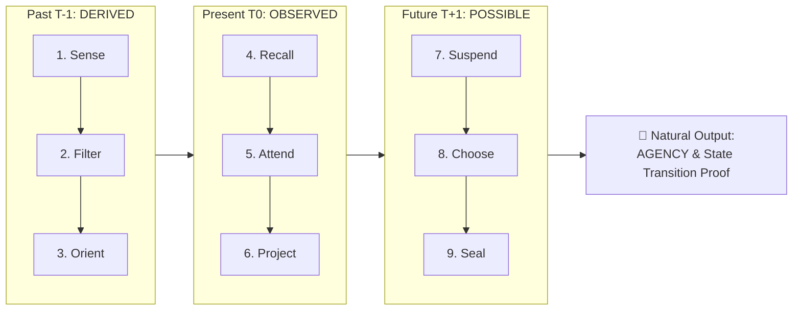
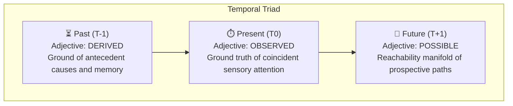

# 🧠 Cognitive Animation & The Temporal Triad

> **"From DERIVED ground, through OBSERVED presence, into POSSIBLE futures — intentionality collapses into verifiable Agency."**

---

## 🧭 Overview

Cognitive animation describes the continuous energetic and informational process by which an intelligent observer synthesizes past experience, perceives current state, and projects into the future to execute deliberate action.

In the **ViperCrest Agnostic 9x9 Protocol**, human cognitive animation maps directly to deterministic state progression across the nine sectors ($F_1 \to F_9$) and the three fundamental temporal planes.

---

## ⚡ The 9 Actions of Cognitive Animation

| Step | Action | Cognitive Mechanism | Matrix Invariant Mapping |
| :---: | :--- | :--- | :--- |
| **$T_1$** | **Sense** | Raw intake of environmental stimulus and sensory telemetry. | Sector 1 ($F_1$): Ingestion, raw payload receipt, hardware handshake. |
| **$T_2$** | **Filter** | Noise suppression, anomaly triage, and threshold gating. | Sector 2 ($F_2$): Allowlist validation, packet filtering, sanitization. |
| **$T_3$** | **Orient** | Situational framing, relational anchoring, and coordinate mapping. | Sector 3 ($F_3$): Session hashing, coordinate projection, context binding. |
| **$T_4$** | **Recall** | Retrieval of prior models, invariants, and historical precedent. | Sector 4 ($F_4$): Immutable ledger reference, prior state lookup, cache. |
| **$T_5$** | **Attend** | Focal convergence and active concentration on critical variables. | Sector 5 ($F_5$): Focal invariant evaluation, AST decomposition, probe analysis. |
| **$T_6$** | **Project** | Simulation of hypothetical forks, state transitions, and outcomes. | Sector 6 ($F_6$): Symbolic simulation, execution trace projection, fuzzing. |
| **$T_7$** | **Suspend** | Deliberate inhibition of reflexive execution to verify constraints. | Sector 7 ($F_7$): Air-gap fail-closed check, boundary verification, safety halt. |
| **$T_8$** | **Choose** | Collapse of branches into a single deterministic trajectory. | Sector 8 ($F_8$): Consensus commitment, rule match, transaction signature. |
| **$T_9$** | **Seal** | Physical execution, irreversible state mutation, and ledger integration. | Sector 9 ($F_9$): Block write, receipt generation, SHA-256 seal. |

---

## ⏳ The Temporal Triad: 3 Adjectives

Every conscious or computational cycle spans three temporal states, each characterized by a foundational adjective:

### 1. Past ($T_{-1}$): `DERIVED`
- **Definition**: That which is already determined, accumulated, or computed from prior interactions.
- **Attributes**: Antecedent, Immutable, Empirical, Historical, Evidentiary.
- **Cognitive Function**: Memory, habit, learned representations, trauma, and identity.
- **Computational Role**: The genesis hash, SQLite ledger history (`runtime/viper_state.db`), and hard-coded invariants.

### 2. Present ($T_0$): `OBSERVED`
- **Definition**: The immediate, knife-edge coincidence of conscious focus and sensory awareness.
- **Attributes**: Coincident, Sensory, Active, Critical, Ground Truth.
- **Cognitive Function**: Real-time awareness, active attention, and constraint validation.
- **Computational Role**: Current input payload, live memory telemetry, hardware status, and runtime gatekeeper checks.

### 3. Future ($T_{+1}$): `POSSIBLE`
- **Definition**: The forward cone of potential states reachable from the observed boundary conditions.
- **Attributes**: Prospective, Plausible, Reachable, Contingent, Uncommitted.
- **Cognitive Function**: Anticipation, goal formation, risk forecasting, and strategy.
- **Computational Role**: Projected state transitions, simulation traces, and candidate block proposals.

---

## 🪡 Sewing the Fabric: The Natural Output

When the **9 Actions** are synthesized across the **3 Temporal Adjectives**, what is the natural, inevitable output?

$$\text{DERIVED (Memory)} \;\xrightarrow[\text{Filter, Orient, Recall}]{\text{Sense}}\; \text{OBSERVED (Attention)} \;\xrightarrow[\text{Suspend, Choose, Seal}]{\text{Project}}\; \text{POSSIBLE (Reachability)}$$

### 1. In Biological Cognition: `AGENCY`
The natural output of cognitive animation is **Agency** — the capacity of an autonomous entity to act intentionally, self-determine its course, and produce irreversible physical outcomes rather than merely reacting as a passive automaton.

### 2. In ViperCrest Architecture: `IMMUTABLE STATE TRANSITION PROOF`
In deterministic computation, Agency is mathematically formalized as an **Immutable State Transition Proof**:
- **Proof of Antecedent**: Rooted in a verifiable `DERIVED` ledger hash.
- **Proof of Observation**: Validated against `OBSERVED` invariant bounds ($F_1 \to F_5$).
- **Proof of Lawful Selection**: Chosen from allowable `POSSIBLE` transitions ($F_6 \to F_8$).
- **Proof of Sealing**: Cryptographically stamped in $F_9$ with SHA-256 and stored in the SQLite ledger.

---

## 🔗 Related Notes
- [[Home]]
- [[System Architecture]]
- [[Agnostic 9x9 Matrix Protocol]]
- [[Session Router & Intent Management]]
- [[Matrix Evaluation Runbook]]
