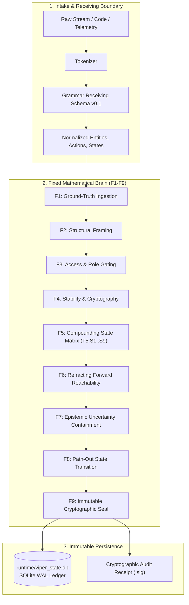

# 🏗️ ViperCrest System Architecture

ViperCrest is an **air-gapped, invariant-enforcing intelligence engine** designed to evaluate physical and digital systems without external network dependence or unverified state hallucination.

---

## 🏛️ High-Level Architectural Layout

---

## 🔒 Core Invariants & Boundaries

1. **Air-Gap Containment:**
   All evaluation logic executes strictly on local memory and disk. No runtime telemetry or code is leaked to external cloud APIs.
2. **The Golden Invariant:**
   *Grammar identifies what was expressed; it does not determine what that expression means or what the system should conclude.*
3. **F7 Epistemic Preservation:**
   If evidence is missing, unobserved, or ambiguous, it is held strictly in **F7 Unresolved**. The system never guesses or fills gaps with synthetic assumptions.
4. **Fail-Closed Execution:**
   Any invariant violation or parameter overflow halts execution with an exit code of `1`.

---

## 📁 Key Files & Modules
* `viper_matrix.py`: The 81-state matrix engine and 729-coordinate tensor space.
* `grammar_schema.py`: Tri-source grammar normalization (English, OS sensors, JSON events).
* `reader_engine.py`: Multi-language code reader and plain-English report generator.
* `ai_contract.py`: AI typed contract boundary enforcing `UNVERIFIED_INPUT`.
* `ai_wrapper.py`: Human-facing language wrapper and interactive AI shell.

---
*Links: [[Home]] | [[Agnostic 9x9 Matrix Protocol]] | [[Shorthand Commands Quick Reference]]*
