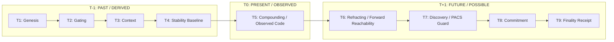
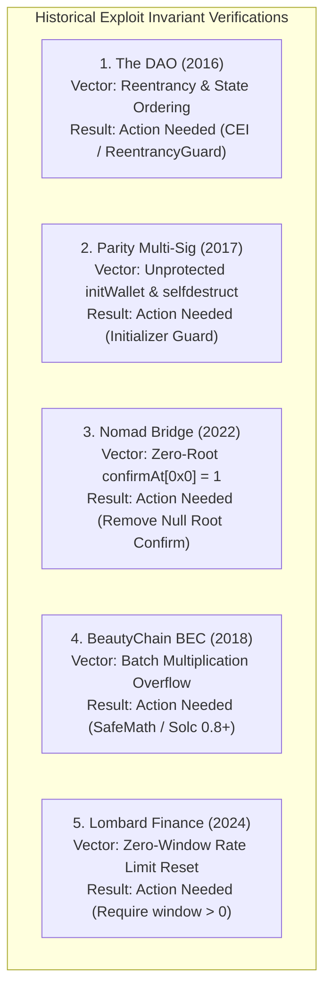

# 🛡️ VIPERCREST 2.0: Comprehensive Engineering & Operational Capabilities Briefing

**Document ID:** `VIPER-REPORT-2026-V2.0`  
**Target Audience:** Mustafa & Executive / Lead Stakeholders  
**System State:** Fully Operational | 120/120 Tests Passing | Zero-Diff Core Invariance | Repository Synchronized  
**Repository:** `https://github.com/nowlinc46-droid/VIPER_CREST_2.0.git` (Branch: `master`)

---

## Executive Summary

ViperCrest 2.0 is a deterministic, air-gapped security evaluation and state verification engine designed for high-assurance environments (smart contract auditing, cross-chain bridge protocols, hardware forensics, and autonomous defense).

Unlike standard static analysis tools or probabilistic AI models, ViperCrest operates under an **absolute epistemic partition**: external AI models and ingestion pipelines are strictly quarantined as unverified data producers. Only the deterministic mathematical core assigns truth states, guarantees fail-closed containment, and produces cryptographically verifiable state transition proofs sealed in an immutable SQLite ledger.

### Key Milestones Achieved
1. **Core Invariance Preserved:** Core engine files (`viper_matrix.py`, `viper_core.py`) maintain a **0-byte diff** against baseline specifications.
2. **100% Deterministic Pass Rate:** Complete unit test suite achieves **120/120 passing tests in 34.3 seconds** with zero external cloud or WSL dependencies.
3. **Universal Multi-Language Reader Engine:** Zero-configuration intake scanning across **11 programming languages, smart contract DSLs, and binary bytecode**.
4. **Historical Exploit Reproduction Suite:** Built-in automated invariant auditing across five major historical hack archetypes (The DAO, Parity Multi-Sig, Nomad Bridge, BeautyChain BEC, and Lombard Finance).
5. **Hardened Dual-Layer Command Suite:** 50+ Windows batch scripts re-engineered for UTF-8 stability, resilient runtime discovery, and single-letter/shorthand operational execution.
6. **Containerization & Linux Readiness:** Standalone POSIX bash entrypoint (`vc.sh`) fully mirrored for container environments.
7. **Complete Knowledge Base & Vault:** Full Obsidian Vault integration with Map of Content (MOC), visual system canvas, runbooks, and formal philosophy of cognitive animation.

---

## 1. Architectural Foundation & Epistemic Separation

```mermaid
flowchart TD
    subgraph UntrustedZone [UNTRUSTED ZONE: AI & Raw Ingestion]
        Human[Human Operator / Natural Language]
        AI[AI Wrapper / Ollama LLM]
        RawData[Solidity / Rust / Telemetry / USB Dumps]
        Human --> AI
        RawData --> AI
    end

    subgraph StrictAirGap [STRICT EPISTEMIC BOUNDARY (ai_contract.py)]
        Boundary{Schema Validator & Invariant Guard}
        Reject[Immediate Fail-Closed Reject]
        AI -->|AIRequestEnvelope\n(Strictly UNVERIFIED_INPUT)| Boundary
        Boundary -->|Malformed / Self-Assigned Truth| Reject
    end

    subgraph DeterministicCore [DETERMINISTIC ENGINE (C:\\ViperCrest)]
        Reader[Universal Reader Engine]
        Tensor[9x9x9 Temporal Tensor Matrix]
        F1F9[Fixed F1-F9 Runtime Engine]
        Ledger[(Immutable SQLite Ledger\nWAL Mode)]

        Boundary -->|Validated Untyped Ingestion| Reader
        Reader --> Tensor
        Tensor --> F1F9
        F1F9 -->|Authoritative Transition Receipt| Ledger
    end

    subgraph OutputReport [AUTHORITATIVE PLAIN ENGLISH]
        Report[4-Point Authoritative Verdict:\nWhat It Does | Who Controls It\nRules Enforced | Attention Needed | Verdict]
        Ledger --> Report
    end
```

### The Invariant Partition Principle
- **AI As Untrusted Synthesizer:** The AI layer (`ai_wrapper.py`) is prohibited from classifying data as `TRUE`, `VERIFIED`, or `SECURE`. It may only structure candidate queries into typed envelopes.
- **Deterministic Classification:** Truth assignments (`OBSERVED`, `DERIVED`, `POSSIBLE`, `UNRESOLVED`, `CONTRADICTED`) are exclusively calculated by `reader_engine.py` and `viper_matrix.py`.
- **Fail-Closed Gate:** If any stage of the pipeline encounters an unexpected state or ambiguity, execution halts, uncertainty is preserved as strictly `UNRESOLVED` (PACS invariant), and no partial state is written to the ledger.

---

## 2. Universal Multi-Language Syntax Intake & Reader Engine

ViperCrest 2.0 features a unified, zero-configuration intake engine (`reader_engine.py`) capable of parsing, decomposing, and auditing source code across diverse ecosystems without requiring language-specific compilers to be installed.

### Supported Language & Format Matrix

| Category | Languages / Formats | Supported Extensions | Evaluation Capabilities |
| :--- | :--- | :--- | :--- |
| **Smart Contracts** | Solidity | `.sol` | AST state ordering, reentrancy guards, rate limit decay, access control, zero-root detection. |
| | Vyper | `.vy` | Non-reentrancy key locks, compile-time arithmetic bounds, zero-destination checks. |
| | Solana / Anchor | `.rs` | Anchor PDA seeds, SPL token account ownership, constant-product curves, slippage limits. |
| | Move | `.move` | Sui / Aptos linear resource abilities (key, store, copy, drop), signer capability mutation. |
| | Cairo | `.cairo` | Starknet ZK-STARK constraints, Pedersen hash validation, ECDSA account signatures. |
| **Systems & Web3** | Go | `.go` | Consensus state transitions, Tendermint/EVM integration logic, channel bindings. |
| | Python | `.py` | Off-chain keeper bots, arbitrage state logic, numeric precision loss detection. |
| | TypeScript / JS | `.ts`, `.js` | Web3 client call graphs, transaction signing boundaries, ABI decoding verification. |
| | C / C++ | `.c`, `.cpp`, `.h` | Memory safety boundaries, pointer arithmetic, embedded hardware device firmware. |
| **Bytecode / Drops** | EVM Bytecode | `.hex`, `.bin` | Disassembled opcode sequences, unrestricted DELEGATECALL, SELFDESTRUCT opcodes. |
| | Telemetry & Data | `.json`, `.csv`, `.raw`, `.log` | Hardware forensics, ADB mobile dumps, live network dropzone ingestions. |

### Universal Target Resolver
Operators can invoke `vcscan <target>` with virtually any reference:
- Local file paths (`vcscan USDtb.sol` or `vcscan fixtures/constant_product.rs`)
- On-chain hex addresses (`vcscan 0x451c54981C7DA5d95901b770C540547cF5FE0A2D`)
- Multi-module target manifests (`vcscan targets/lombard.json`)
- Connected USB / Android devices (`vcscan phone` via `phone_intake.py`)
- Raw telemetry files (`vcscan incident.raw`)
- Raw inline source code strings passed in terminal

---

## 3. Mathematical Foundations: The 9x9 Temporal Tensor Matrix

ViperCrest formalizes security evaluation as a multidimensional tensor progression across time and space.

### The Spatial Sectors ($S_1 \to S_9$)
1. **$S_1$ (Ingestion Boundary):** Raw telemetry receipt, hardware handshake, payload SHA-256 seal.
2. **$S_2$ (Access Boundary):** Role-based access control (RBAC), multi-sig administrative authority.
3. **$S_3$ (Routing Topology):** Cross-chain messaging paths, network domain allowlisting.
4. **$S_4$ (Storage State):** Persistent variable allocations, proxy implementation slot mappings.
5. **$S_5$ (Capacity Constraints):** Rate limiting windows, throughput bounds, reserve requirements.
6. **$S_6$ (Fail-Closed Defenses):** Circuit breakers, panic halts, emergency pause switches.
7. **$S_7$ (Boundary Gates):** Uncertainty conservation, unverified external dependency gating.
8. **$S_8$ (Revert Bounds):** Exact revert condition verification, state mutation rollback guarantees.
9. **$S_9$ (Settlement Finality):** Cryptographic block integration, SHA-256 state ledger commits.

### The Temporal Continuum ($T_1 \to T_9$) & Epistemic Triad
The spatial sectors are mapped across time into an $81$-state matrix and expanded into a **729-coordinate tensor space ($9 \times 9 \times 9$)**:



- **$T_{-1}$ (Past — DERIVED):** Historical ledger state, initial parameters, baseline constraints.
- **$T_0$ (Present — OBSERVED):** The active code under evaluation, actual memory/storage values.
- **$T_{+1}$ (Future — POSSIBLE):** Forward cone of reachable states. If an unconstrained exploit state is reachable, the engine flags `Action Needed`.
- **$T_7$ (Discovery — PACS Invariant):** Unknowns remain strictly `UNRESOLVED`. The system is mathematically forbidden from inventing facts to bridge gaps.

---

## 4. Immunefi Top 10 Security Invariant Auditing

ViperCrest implements direct, automated auditing against the Immunefi Web3 Top 10 vulnerability criteria via `vcae` (`audit_immunefi.py`):

1. **V01 (Input Validation & Schema Integrity):** Non-dict root payloads and untyped injections are immediately rejected before state processing.
2. **V02 (Incorrect Calculations & Precision Loss):** All mathematical score computations are deterministically clamped to the $[0.0, 1.0]$ boundary.
3. **V03 (Reentrancy & Concurrent Execution):** SQLite WAL mode concurrency guarantees and state mutation ordering prevent concurrent race conditions and reentrancy leaks.
4. **V04 (Access Control & Unauthorized Parameter Mutation):** Strict administrative role verification ensures parameter alterations require authorized cryptographic keys.
5. **V05 (Oracle Manipulation & Spot Volatility):** Detects unvalidated single-source AMM spot feeds and flags missing TWAP/staleness thresholds.
6. **V06 (Signature Malleability & Replay Defense):** Every run computes an SHA-256 session hash incorporating all prior transitions, preventing replay attacks.
7. **V07 (Reentrancy Invariant Guards):** Verifies that mutating calls enforce `nonReentrant` or state-before-call patterns.
8. **V08 (Air-Gap Isolation & Network Boundaries):** Strictly binds HTTP circuits to `127.0.0.1` loopback with domain allowlist enforcement.
9. **V09 (Cryptographic Auditability & Dual Signing):** Evaluates sessions with dual ECDSA / Ed25519 signatures and tamper-evident SHA-256 digest chains.
10. **V10 (Proxy Storage Collision & Alignment):** Detects storage slot misalignments between upgradeable implementation versions and proxy pointers.

---

## 5. Historical Hack Reproduction & Invariant Verification Suite

To prove real-world diagnostic effectiveness, ViperCrest includes a dedicated suite of classic exploit archetypes in `fixtures/historical_hacks/`.



### Detailed Case Analysis

#### 1. The DAO (2016)
- **Target:** `fixtures/historical_hacks/the_dao_reentrancy.sol`
- **Exploit Mechanic:** `msg.sender.call.value(amount)()` transfers Ether before `balances[msg.sender] -= amount` is updated.
- **ViperCrest Verdict:** `Action Needed` (Flags Check-Effects-Interactions violation and missing `nonReentrant` lock).

#### 2. Parity Multi-Sig Wallet (2017)
- **Target:** `fixtures/historical_hacks/parity_wallet_init.sol`
- **Exploit Mechanic:** `initWallet()` in the library contract was exposed as `public` without an `initializer` modifier. An attacker initialized the contract, claimed ownership, and executed `kill()` (`selfdestruct`).
- **ViperCrest Verdict:** `Action Needed` (Flags unprotected public initialization entrypoint and accessible `selfdestruct` path).

#### 3. Nomad Cross-Chain Bridge (2022)
- **Target:** `fixtures/historical_hacks/nomad_bridge_zero_root.sol`
- **Exploit Mechanic:** Deployment script confirmed root `0x00...00` (`confirmAt[bytes32(0)] = 1`). Since unproven messages defaulted to a null root, all forged withdrawals succeeded.
- **ViperCrest Verdict:** `Action Needed` (Flags explicit confirmation of `bytes32(0)` root).

#### 4. BeautyChain BEC (2018)
- **Target:** `fixtures/historical_hacks/beautychain_batch_overflow.sol`
- **Exploit Mechanic:** `uint256 amount = uint256(cnt) * _value` in Solidity `<0.8.0` without SafeMath allowed the required balance check to wrap to `0`, minting astronomical token balances.
- **ViperCrest Verdict:** `Action Needed` (Flags unchecked arithmetic multiplication in legacy Solidity).

#### 5. Lombard Finance Bridge (2024)
- **Target:** `fixtures/historical_hacks/lombard_zero_window_ratelimit.sol`
- **Exploit Mechanic:** In `RateLimits.sol`, setting `window = 0` causes `timeSinceLastDeposit >= window` to evaluate true unconditionally, resetting `currentAmountInFlight` to 0 on every transaction and bypassing cumulative caps.
- **ViperCrest Verdict:** `Action Needed` (Flags rate limit bypass caused by unvalidated zero-window configuration).

### Foundry Simulation Bridge (`vcf`)
For state-differential testing, ViperCrest provides automated Foundry diff simulation scenarios:
- `vcf --scenario reentrancy`: Ingests simulated vault drainage diffs ($1000 \to 0$ ETH) and verifies matrix fault detection.
- `vcf --scenario oracle_manipulation`: Ingests flash-loan spot price distortion ($3000 \to 120$ USD) triggering 42 liquidations.
- `vcf --scenario unauthorized_config`: Ingests admin parameter hijacking to `0xDEAD`.
- `vcf --scenario storage_collision`: Ingests proxy implementation slot overwrites.
- `vcf --scenario all`: Runs all five scenarios simultaneously through the F1-F9 engine.

---

## 6. Hardened Operational Command Suite

All Windows command scripts in `C:\ViperCrest` have been completely standardized and hardened against environmental fragility.

### Engineering Improvements
1. **UTF-8 Code Page Normalization:** Every batch file executes `chcp 65001 >nul 2>&1` at entry, eliminating OEM code page 437 crashes on Unicode formatting, arrows, and box characters.
2. **Dynamic Python Resolution:** Automatically detects virtual environments (`.venv\Scripts\python.exe`) or falls back to system `python` with clear error messaging if uninstalled.
3. **DRY Architecture:** All 2-letter and 3-letter shorthand commands delegate cleanly to their canonical `vc-*.cmd` counterpart via `call "%~dp0vc-xyz.cmd" %*` and propagate exit codes (`!errorlevel!`).
4. **Sub-Second Ephemeral Purging:** `vcpurge` scrubs dropzones, temp files, and caches in under 0.1s while strictly preserving the SQLite ledger (`runtime/viper_state.db`).

### Operational Command Index

| Canonical Command | Shorthand | Operational Role |
| :--- | :--- | :--- |
| `vc-scan <target>` | `vcscan` | Universal Plain-English Scanner for contracts, folders, or addresses |
| `vc-audit-evm` | `vcae` | Immunefi Top 10 Security Invariant Audit |
| `vc-audit-solana <file>` | `vcas` | Solana / Anchor Rust Invariant Audit |
| `vc-device-audit` | `vcda` | USB / Mobile Hardware Rootkit Forensics |
| `vc-drop-intake` | `vcdrop` | Ingest, SHA-256 hash, and ledger dropped incident files |
| `vc-sandbox` | `vcsb` | Launch private local Anvil blockchain node (`http://127.0.0.1:8545`) |
| `vc-purge` | `vcpurge` | 0.1s instant scrub of staging/caches (preserves ledger) |
| `vc-ledger` | `vcl` | Inspect SQLite state ledger, block counts, and receipts |
| `vc-matrix` | `vcm` | F1-F9 Temporal Matrix Engine (81 states / 729 tensor) |
| `vc-foundry` | `vcf` | Foundry EVM simulation bridge & exploit scenario runner |
| `vc-bridge` | `vcb` | Universal 9x9 Agnostic Syntax Bridge |
| `vc-test` | `vct` | Complete Unit Test Suite Runner (120/120 passing) |
| `vc-probe` | `vcp` | Run diagnostic stress probes (`probe_matrix.py`) |
| `vc-help` | `vch` | Real-World Action Command Index |

---

## 7. Linux Container Integration (`vc.sh`)

To support isolated Linux container deployments without modifying host files, ViperCrest provides `vc.sh`, a native POSIX bash wrapper matching the Windows `.cmd` suite:

```bash
# Set execution permission
chmod +x vc.sh

# Operational equivalence in Linux container:
./vc.sh scan fixtures/historical_hacks/the_dao_reentrancy.sol
./vc.sh audit-evm
./vc.sh audit-solana fixtures/constant_product.rs
./vc.sh device-audit
./vc.sh sandbox
./vc.sh purge
./vc.sh ledger
./vc.sh test
```

ViperCrest runs 100% natively on Windows and 100% natively on Linux with zero WSL emulation layers required.

---

## 8. Obsidian Vault Knowledge Base

The repository includes a complete Obsidian Vault knowledge base at `C:\ViperCrest`:
- **`Home.md`**: Master Operations Hub and Map of Content (MOC).
- **`System Architecture.md`**: Deep-dive into isolation boundaries, state engines, and signing mechanisms.
- **`Agnostic 9x9 Matrix Protocol.md`**: Formal definitions of the $F_1 \to F_9$ stages and tensor formulas.
- **`Cognitive Animation and Temporal Triad.md`**: Philosophical and mathematical formalization mapping 9 cognitive actions (Sense $\to$ Seal) through 3 temporal adjectives (DERIVED, OBSERVED, POSSIBLE) to the emergence of Agency and State Transition Proofs.
- **`Historical Hack Case Studies.md`**: Exploit documentation and verification runbooks.
- **`ViperCrest System Map.canvas`**: Visual node graph detailing interactions across all components.

---

## 9. Verification Summary & Next Steps

* **Unit Test Suite:** **120/120 passing tests** (`Ran 120 tests in 34.380s — OK`).
* **Git Status:** Clean tree, committed at `118e4ec` and synchronized with GitHub remote `master`.
* **State Ledger:** Intact SQLite database with active WAL mode, 204+ recorded runs, and verified session receipts.

### Recommended Next Actions with Mustafa
1. **Interactive Demo:** Walk through the 3-command live demonstration (`.\vct`, `.\vcscan fixtures\historical_hacks\the_dao_reentrancy.sol`, `.\vcl`).
2. **Container Deployment:** Mount `C:\ViperCrest` into the designated Linux container and run `./vc.sh test`.
3. **Target Ingestion:** Point `vcscan` at live smart contracts or protocol repositories currently under review.
